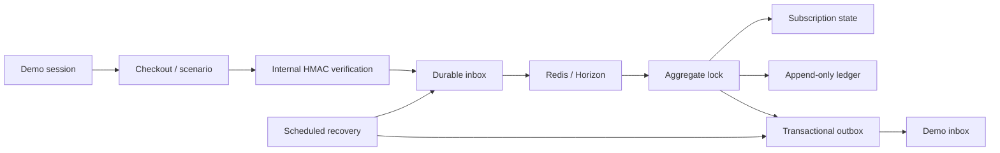

# Architecture

A modular monolith keeps the payment mutation, ledger posting and outbox write in one PostgreSQL transaction. `Domain` holds money, lifecycle rules and provider contracts; `Application` coordinates use cases; `Infrastructure` implements the simulator; HTTP and Livewire expose session-scoped actions.

A delivery is distinct from an event. `(provider, environment, external_event_id)` identifies one event; a changed payload under that identity is rejected. Jobs lock the demo session, order and event before applying effects. A scheduled scan recovers the gap between database commit and queue dispatch. Deferred events have bounded exponential backoff; exhausted events can be reprocessed by their session owner.

Money uses integer minor units. Each ledger transaction has one currency, at least two entries and equal debits and credits, enforced by deferred PostgreSQL triggers. Transactions and entries cannot be edited or deleted; new entries cannot be appended after commit. Refunds and dispute recovery create separate reversals. Invoice numbers are allocated under a sequence row lock at issuance.

Provider choice applies to a new order. Existing payments and subscriptions retain their originating provider. The capability matrix describes simulator availability, including unavailable operations. The internal HMAC format is not a Stripe, PayPal or Mollie verification scheme. Native sandbox adapters require separate verification and contract tests before activation.

Livewire polls every two seconds. This keeps the transport simple; it is not SSE. Tax uses synthetic fixtures and always retains a review decision. The demo outbox destination is a database inbox, which makes delivery retries testable without sending external email.
