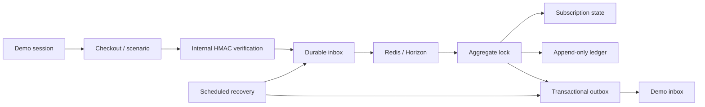

# Architecture

A modular monolith keeps the payment mutation, ledger posting and outbox write in one PostgreSQL transaction. `Domain` holds money, lifecycle rules and provider contracts; `Application` coordinates use cases; `Infrastructure` implements the simulator; HTTP and Livewire expose session-scoped actions.

Splitting these writes across services would introduce partial failures without a useful deployment boundary for this lab. Redis carries jobs, while PostgreSQL remains the source of truth. Locking the session serializes its mutations and simplifies replay recovery; this favors isolation and correctness over throughput within one demo session.

A delivery is distinct from an event. `(provider, environment, external_event_id)` identifies one event; a changed payload under that identity is rejected. Jobs lock the demo session, order and event before applying effects. A scheduled scan recovers the gap between database commit and queue dispatch. Deferred events have bounded exponential backoff; exhausted events can be reprocessed by their session owner.

Money uses integer minor units. Each ledger transaction has one currency, at least two entries and equal debits and credits, enforced by deferred PostgreSQL triggers. Transactions and entries cannot be edited or deleted; new entries cannot be appended after commit. Refunds and dispute recovery create separate reversals. Invoice numbers are allocated under a sequence row lock at issuance.

Provider choice applies to a new order. Existing payments and subscriptions retain their originating provider. The capability matrix describes simulator availability, including unavailable operations. The internal HMAC format is not a Stripe, PayPal or Mollie verification scheme. Native sandbox adapters use separate verification and are covered by HTTP contract tests before activation; credentialed smoke tests are still required on the VPS.

Livewire polls every two seconds. This keeps the transport simple; it is not SSE. Tax uses synthetic fixtures and always retains a review decision. The demo outbox destination is a database inbox, which makes delivery retries testable without sending external email.

## Native sandbox flow

A gated session creates an order with environment `sandbox`. Catalog provisioning is an explicit Artisan command. `sandbox_operations` records the request, credential fingerprint, stable provider key, lease and result. Reservations serialize mutations per order. HTTP runs outside the database transaction; uncertain results retry the original key only inside the retention window.

Webhook ingress authenticates the sender/resource, maps it to an existing sandbox order, persists a sanitized wake-up event and acknowledges delivery. The worker fetches current provider state rather than applying an old notification payload. Snapshot versions prevent slower concurrent reads overwriting newer state. Late deliveries are processed after session expiry and reopen cleanup if needed.

`SandboxState` checks ownership, environment, initial amount, currency, refund bounds and known prices. Every renewal is identified by an external payment ID and receives independent ledger/invoice/outbox references. Pending refunds reserve refundable capacity; confirmed refunds reverse cash once. Disputes produce hold/loss/recovery entries. A canceled subscription cannot reactivate from stale state, but verified late payments still enter accounting.

`sandbox:maintain` retries uncertain operations, reconciles orders, performs scheduled cancellations and cancels expired resources in bounded batches. Failed attempts are tracked separately from successful reconciliation timestamps. A manual adoption command validates an existing remote resource and resolves its operation without creating it again. Financial records remain append-only; schema rollback is refused if renewals violate the old one-payment-per-order constraint.
